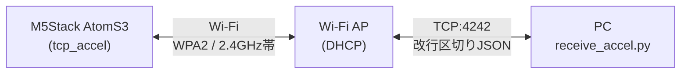

# cqif-zephyr-networking

[Interface 2027年1月号](https://interface.cqpub.co.jp/magazine/202701/)の特集「新定番マイコンOS Zephyrガイドブック」における下記の記事のために作成した，Zephyr RTOSによるネットワーク通信のサンプルプログラム集です．

- 第3部第5章　ネットワーク機能の深掘り② Wi-Fiでセンサ・データを配信する

M5Stack AtomS3に内蔵された加速度センサ（MPU6886）の値を取得し，Wi-Fi経由のTCP通信でPCへJSON形式のデータとして送信します．

各コミットのメッセージには，記事中のリスト番号（例：`（リスト15）`）を記載しています．`git log`でコミット履歴をたどることで，記事のリストとコードの対応を確認できます．



## 必要なもの

### ハードウェア

- [M5Stack AtomS3](https://docs.m5stack.com/en/core/AtomS3)（ESP32-S3搭載，加速度センサMPU6886内蔵）
- USB Type-Cケーブル（書き込みとシリアルモニタ用）
- 2.4GHz帯・WPA2-PersonalのWi-Fiアクセスポイント（DHCPが有効であること）

### ソフトウェア

- [Zephyr RTOS](https://www.zephyrproject.org/) v4.4.2（後述のwestマニフェストで取得します）
- Zephyr SDK（[公式ドキュメント](https://docs.zephyrproject.org/latest/develop/getting_started/index.html)の手順でインストール）
- west（Zephyrのメタツール．後述のPython仮想環境にインストールします）
- Python 3.10以降（west用およびPC側の受信スクリプト用）

## リポジトリ構成

```text
.
├── manifest/west.yml        # Zephyr v4.4.2を固定するwestマニフェスト
├── apps/
│   ├── accel_read/          # 加速度データをシリアルコンソールへ出力するアプリ
│   ├── tcp_accel/           # 加速度データをTCPで配信するサーバアプリ
│   └── common/              # 両アプリで共有するセンサ・ネットワークのコード
│       ├── accel.{c,h}      # MPU6886からの取得とJSON形式への変換
│       ├── network.{c,h}    # Wi-Fi接続とIPv4アドレス取得の待機
│       └── wifi_credentials.h.example  # Wi-Fi認証情報のテンプレート
└── receive_accel.py         # PC側の受信・表示スクリプト
```

## セットアップ

### 1. Python仮想環境の作成とwestのインストール

このリポジトリをクローンし，Python仮想環境（venv）を作成してwestをインストールします．

```console
git clone https://github.com/takasehideki/cqif-zephyr-networking.git
cd cqif-zephyr-networking
python3 -m venv .venv
source .venv/bin/activate
pip install west
```

以降の手順は，この仮想環境を有効化した状態で実行してください（シェルを開き直した場合は`source .venv/bin/activate`を再実行します）．

### 2. westワークスペースの構築

このリポジトリをワークスペースのルートとしてwestを初期化し，Zephyr本体と関連モジュールを取得します．

```console
west init -l manifest
west update
west packages pip --install  # Zephyrが必要とするPythonパッケージのインストール
west blobs fetch hal_espressif  # ESP32用のバイナリblobの取得
```

### 3. Wi-Fi認証情報の設定

テンプレートをコピーして，接続先アクセスポイントのSSIDとパスワードを記述します．

```console
cp apps/common/wifi_credentials.h.example apps/common/wifi_credentials.h
```

```c
#define WIFI_SSID "YOUR_SSID"
#define WIFI_PASSWORD "YOUR_PASSWORD"
```

`wifi_credentials.h`は`.gitignore`に登録されており，Gitの管理対象外です．誤ってコミットされることはありませんが，取り扱いには注意してください．

## ビルドと実行

### accel_read：加速度データのシリアル出力

まずはネットワークを使わずに，センサの動作をシリアルコンソールで確認できます．

```console
west build -b m5stack_atoms3/esp32s3/procpu apps/accel_read
west flash
west espressif monitor
```

100ms周期で以下のようなJSONが出力されます．

```text
{"seq":0,"uptime_ms":123,"ax":0.057456,"ay":-0.124578,"az":9.812345}
```

### tcp_accel：加速度データのTCP配信

```console
west build -b m5stack_atoms3/esp32s3/procpu apps/tcp_accel
west flash
west espressif monitor
```

起動するとWi-Fiに接続し，取得したIPv4アドレスがログに表示されます．

```text
<inf> app_network: Wi-Fi connection requested
<inf> app_network: IPv4 ready: 192.168.11.101
<inf> tcp_accel: TCP acceleration server listening on 4242
```

### PC側での受信

まずは`nc`（netcat）コマンドで，表示されたIPv4アドレスへ接続し，送信されるJSONをそのまま受信できることを確認します．

```console
nc 192.168.11.101 4242
```

```text
{"seq":0,"uptime_ms":1234,"ax":0.057456,"ay":-0.124578,"az":9.812345}
{"seq":1,"uptime_ms":1334,"ax":0.061123,"ay":-0.119456,"az":9.808012}
...
```

受信用のPythonスクリプトもサンプルとして用意してあります．
JSONから取り出した値が単位と桁数をそろえて表示されます．

```console
python3 receive_accel.py 192.168.11.101
```

```text
seq=     0  t=   1.234 s  ax=   0.057  ay=  -0.125  az=   9.812 m/s^2
seq=     1  t=   1.334 s  ax=   0.061  ay=  -0.119  az=   9.808 m/s^2
...
```

`Ctrl+C`で終了します．切断後もAtomS3側はサーバとして動作し続けるため，再度接続できます．

## 通信プロトコル

tcp_accelはTCPのポート4242で接続を待ち受け，接続したクライアントへ100ms周期で改行区切りのJSON（1サンプル1行）を送信します．

| フィールド | 型 | 内容 |
|---|---|---|
| `seq` | 整数 | サンプルの連番（0始まり） |
| `uptime_ms` | 整数 | 起動からの経過時間[ms] |
| `ax`, `ay`, `az` | 数値 | 3軸の加速度[m/s^2] |

同時に接続できるクライアントは1台です．この仕様に沿えば，`receive_accel.py`以外の自作クライアントからも受信できます．

## トラブルシューティング

- **ビルドが失敗する**：`west blobs fetch hal_espressif`を実行したか確認してください．ESP32-S3のWi-Fi機能にはバイナリblobが必要です．
- **`Network connection failed`と表示される**：接続先が2.4GHz帯・WPA2-Personalであるか，SSID・パスワードが正しいかを確認してください．5GHz帯専用のアクセスポイントには接続できません．
- **`IPv4 ready`が表示されず`-116`（タイムアウト）で終了する**：アクセスポイントのDHCPが有効か確認してください．IPv4アドレスの取得は最大30秒で打ち切られます．
- **PCから接続できない**：PCとAtomS3が同じネットワークに属しているか，ルータのクライアント間分離（プライバシーセパレータ）機能が無効かを確認してください．

## ライセンス

[Apache License 2.0](./LICENSE)
